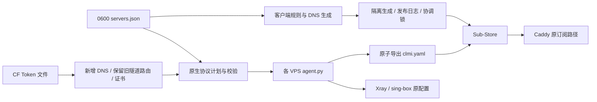

# ArgoSBX Fleet
初始化与维护 ArgoSBX + Cloudflare Tunnel + Sub-Store 安装。支持多机协议参数、订阅生成、发布恢复及增量域名迁移。代理内核继续由原生 systemd 服务运行，不依赖 Ti、3x-ui、Docker 或新增常驻管理进程。
## 结构

## 安装维护工具
需要 Python 3.10+、PyYAML。不会替换或重启 Xray、sing-box、cloudflared、Caddy、Sub-Store；此命令仅更新维护代码；空白 VPS 全量初始化使用下方 `onboard.py install`。
从 GitHub Release 下载版本包和 SHA256SUMS，核验后运行：
```sh
sha256sum -c SHA256SUMS
python3 install.py argosbx-fleet-v1.2.10.tar.gz --sha256 <已核对的SHA256>
```
安装到 `/opt/argosbx-fleet/<版本>`，原子更新 `current` 符号链接。同一版本内容不可覆盖。升级使用相同命令；数据与凭据不在发布包内。
## 配置入口
复制 `templates/servers.example.json` 到私有路径，设置权限 0600；通过 `ARGOSBX_SERVERS_FILE` 指定。`ARGOSBX_WORKSPACE` 用于解析相对 SSH 路径；`ARGOSBX_STATE` 为计划和恢复日志目录。设置 `coordinator` 为运行 Sub-Store 的服务器 ID，使用该机原生 `flock` 排除跨工作站同时发布。每次 Sub-Store 请求前后检查锁连接；检测到连接断开就停止写入并保留恢复日志。它不提供服务端数据库 fencing，已在途的请求仍须回读确认。
初次接管现有安装：向各 VPS `agent.py adopt` 标准输入传递 `{server_id, services}`；services 是原生配置完整路径到 systemd unit 的映射。程序读取实际端口、TLS 参数、凭据和源节点，校验两个内核并确认接管前后正式节点等价，再保存 `/etc/argosbx-fleet/server.json`。同类协议存在多个入站时拒绝自动猜测；需要先明确映射。
```sh
python3 fleetctl.py inspect --server jp
python3 fleetctl.py protocol-plan --server jp
python3 fleetctl.py protocol-apply --server jp
python3 servers.py plan
python3 servers.py publish
```
`protocols` 包含 `reality/hy2/cf/anytls/shadowtls/salamander/xhttp`，各自显式设置 enabled、port、listen；TLS 协议通过 certificate 引用 certificates 中的证书文件。另有 sni、cover_host、cover_port、alpn、ws_path、padding_scheme、client 参数。导出根据协议标识和原生配置读取凭据，不依赖节点数组下标、固定端口、固定 tag。直接编辑 native 文件会触发漂移保护，不会无声发布不一致节点。生成器显式使用本次 inventory；多次生成及域名迁移不会沿用模块导入时的旧域名映射，私有 payload 从创建起即为 0600。schema=2 必须显式填写已登记协议的完整参数和证书绝对路径；不支持的参数会报错，清空 client 选项或 ALPN 后不会从旧模板继承。只部署部分协议的服务器不会生成不存在的 Shadowrocket 节点；整台停用应从汇总配置移除，不能发布空国家组。
启停监听、修改端口等需要原生服务重启；默认拒绝修改。只有明确维护窗口才使用 `protocol-apply --allow-restart`。普通参数计划、订阅调整、导出器升级均不重启代理。`enabled=false` 会从服务端和订阅同时移除该入口；已有凭据保留在私有接管状态中，便于再次启用。
## 发布与恢复
`servers.py plan` 创建随机命名的临时 Sub-Store 对象，使用原生转换器校验 Clash、Stash 和 Shadowrocket 分组，随后删除。`publish` 检查输入和每个线上对象未被修改，记录写前日志后更新并回读原统一地址。它是可恢复的多对象发布，不是 Sub-Store 数据库级原子事务。

Sub-Store 的 `/download/collection/all` 和单服务器导出会按客户端返回完整配置：FlClash 使用 Clash 模板，Stash 使用独立 Stash 模板，包含分组、分流、DNS 与去广告。可以用 `target=Stash` 明确指定格式，URL 路径中的目标优先于查询参数和 User-Agent。Stash 请求会根据版本决定是否包含 XHTTP／VLESS Encryption（iOS/tvOS ≥ 3.6、macOS ≥ 4.3）；旧版或无法识别版本时，使用不含这类节点的 3.4 兼容集合，其余节点及规则保留，国家组随实际节点重建。服务端不会移除协议入口，也不会改写加密凭据。版本依据为 [Stash 官方协议说明](https://stash.wiki/proxy-protocols/proxy-types#xhttp)。`/api/file/stash` 使用同一版本兼容逻辑，无需更换原地址；直接文件请求及通用下载均按原始客户端 User-Agent 生成配置。旧版或无法识别版本时过滤 XHTTP／VLESS Encryption，支持的版本保留完整字段。分组在过滤后重建，文件响应设置 YAML 类型、`Vary: User-Agent` 和 `Cache-Control: private, no-store`，避免不同版本混用缓存。

发布前后同时校验文件地址和通用下载地址，覆盖 iOS、macOS、新旧版本与无版本请求，检查 Stash 兼容集合、现代 Stash 全节点配置及 FlClash 输出。不能用 Mihomo 解析成功代替 iPhone Stash 真机验收。
进程或网络中断后运行 `servers.py recover`，按线上内容恢复本次写入并清理临时对象。恢复前先核对所有待恢复对象，遇到第三方修改保留日志并拒绝开始覆盖。临时对象按资源清单核对存在性，已删除、未创建或删除响应丢失均可重复恢复，清理进度逐项落盘。日志0600、原子替换并 fsync；成功后删除，不长期累计备份。不要绕过工具在发布期间编辑同一 Sub-Store 对象。
服务器端未完成的协议事务由 `fleetctl.py protocol-recover --server jp` 恢复；已尝试重启过的服务在恢复时也会重启，未重启过的事务不会触发服务重启。恢复命令也默认拒绝重启，只有明确指定 `--allow-restart` 才会恢复已重启的服务；恢复前统一核对原生文件、登记状态和订阅源，存在外部修改时整次停止。恢复同时还原源文件和读取权限，清除过期计划；未恢复事务会阻止定时导出和发布。
## 域名迁移
CF Token 通过本机 0600 文件引用，不写进 Git 或子进程参数。权限为 Zone Read、DNS Edit、Account Cloudflare Tunnel Edit，限制到目标 zone/account；R2/S3 Token 不可替代。`Cloudflare.zones()` 支持分页读取授权范围内的域名。
私有配置增加 `cloudflare.token_file`，目标服务器增加 `domain_migration: {zone, tunnel_id, names: {ipv4, ipv6, cf, certificate}}`。
```sh
python3 fleetctl.py domain-plan --server jp
python3 fleetctl.py domain-stage --server jp
python3 fleetctl.py domain-commit --server jp
```
先新增 DNS 和隧道路由，保留原名称；遇到已有不一致记录拒绝覆盖。Caddy 使用现有进程热加载签发证书，证书就绪后才能提交协议引用。若进程中断在 DNS 完成、证书登记之前，提交会停止，必须先恢复再重新执行，不能跳过证书阶段。证书身份切换涉及原生进程重新加载时默认停止，待维护窗口指定 `--allow-restart`。新连接地址可以继续使用原证书 SNI；只有显式要求更换 TLS 身份才安排切换。原订阅 URL、认证路径和源地址不随域名迁移改变。
域名恢复使用 `domain-recover`，仅删除带本次事务标记的新增 DNS，避免误删他人记录。提交后的 DNS 不单独删除；先恢复客户端与服务端引用。实际新域名切换必须有有效管理 Token 和目标域名，本仓库的模拟测试不能代替真实外网验收。
## 分流与测速
继续使用 [MetaCubeX/meta-rules-dat](https://github.com/MetaCubeX/meta-rules-dat) 国内域名/IP 与广告集合，日更且使用客户端缓存。优先保留 Google Play、AI、Telegram 例外；飞书业务/静态资源显式直连。Clash 的国内 DNS 跟随相同国内规则集，新版 Stash 同样引用国内路由规则集；旧版及未知版本保留 geosite:cn 兼容分支；国内走 AliDNS HTTPS，国外走代理上的 Cloudflare HTTPS。禁用明文 DNS 回退，节点解析保留独立启动路径。Shadowrocket 使用对应 ChinaMax DOMAIN-SET；其 DNS 覆写用于直连规则，改用国内 DoH，代理域名仍交给节点解析，保留独立原生格式。参见 [Stash DNS](https://stash.wiki/features/dns-server)、[Mihomo DNS](https://wiki.metacubex.one/config/dns/) 及 [Shadowrocket 配置说明](https://github.com/LOWERTOP/Shadowrocket/wiki#修改dns)。
`health.interval` 统一支持 900 或 1800 秒，默认 900。日常、AI、Telegram、国家自动组及现有节点名称保留；去广告开关按客户端原生能力适配。Clash/FlClash 导出始终是带规则分组的完整配置。

设为 `1800` 可统一每 30 分钟自动测速。Stash 的上层选择组显式关闭独立测速，只由使用中的国家自动组执行定时检测，避免其默认 600 秒递归测速覆盖预期间隔；手动测速及国家组自动选择仍可使用。
UU 远程、向日葵与 ToDesk 的服务域名及其 DNS 显式直连。Clash/FlClash 将这些域名从 Fake-IP 排除，并按进程名前缀匹配主程序、服务和辅助进程，覆盖纯 IP 的 TCP/UDP 中继与 P2P；需要运行在能识别本机进程的客户端上，不能据此保证其他设备经路由器转发的流量。明文 DNS 防护仍优先；Stash/Shadowrocket 仅使用各自兼容的域名规则，不下发 Mihomo 专用进程正则。
## 验证
```sh
python3 -B -m unittest discover -s tests -v
python3 release.py dist
```
测试涵盖协议参数、导出、并发/中断恢复、域名冲突、发布格式和升级校验。生产验收额外比较代理进程 PID、原生配置哈希、订阅节点、原统一 URL 和隔离客户端连接。HTTP 200 只代表请求成功，不等于登录后的业务全过程已验收。

## 证书与线上检查
`fleetctl.py inspect --server jp` 返回 `certificate_health`：剩余天数、14 天续期提醒、SNI/私钥匹配和有效期。计划、应用和订阅发布均阻止未生效、失效、不足 24 小时或不匹配的证书。检查只读，不自行续签、重启或修改现有 Caddy 自动续期流程。

## v1.1：空白服务器一键接入
控制机需要 Python 3.10+、PyYAML、OpenSSH；目标为 root 可 SSH 登录的空白 Ubuntu/Debian amd64 或 arm64。先核实主机指纹并写入专用 known_hosts，不能关闭 SSH 身份校验。控制机 `cloudflare.token_file` 指向 0600 Token 文件，权限为所选域名 Zone Read、DNS Edit，所选账号 Cloudflare Tunnel Edit；管理 Token 不上传 VPS，VPS 仅保存独立隧道连接 Token。
```sh
python3 onboard.py zones --config /private/servers.json
python3 onboard.py add --config /private/servers.json --server jp2 --country JP --country-name 日本 --ipv4 192.0.2.20 --zone example.com --ssh-key ~/.ssh/vps --known-hosts ~/.ssh/vps_known_hosts
python3 onboard.py install --config /private/servers.json --server jp2
```
`add` 生成完整可编辑的默认值、独立域名及随机私密源路径，状态为 `pending`，不会参与现有服务器发布。`install` 串联主机检查、校验固定版本二进制、创建固定隧道、DNS、Caddy ACME 证书、两个代理内核、导出定时器、外部 HTTPS 源验收、独立客户端逐协议 HTTPS/出口 IP/UDP 验收，再登记 Sub-Store 源、更新原订阅并转为 `active`。验收使用其他已启用服务器的临时回环客户端；IPv6 需有另一台具备 IPv6 的验收端，条件不足或任一检查失败均保持 `pending`。已有统一地址不变。不得把现有 VPS 当成空白机；检测到已有安装即拒绝覆盖。安装中断后用原配置重复同一命令续装，保留第一次生成的节点凭据。
证书通过 Caddy 自动续期，协议使用稳定文件引用。云防火墙需要提前放行 TCP 80/443/8443/2447/2448 和 UDP 2446/8443（若调整端口，以初始化检查输出为准）；主机 UFW 已启用时仅追加这些端口，不清空规则。服务商防火墙没有通用 API，安装器不会冒充已自动放行。独立验收证明服务器之间可达，用户所在地的运营商路径仍可能不同。CF 创建失败保留私有接入日志，未知响应通过同一随机隧道名称回读，避免重复创建。

## 多入站模型
现有六种协议类型均可首次新增或增设多个入口。复制 `protocols.anytls` 到 `protocols.anytls_second`，增加 `"type":"anytls"`、更换未占用端口，即得到独立凭据和带 `@anytls_second` 后缀的节点。CF 入站需独立 WS 路径；域名可以共用。应用时自动同步所选服务器的隧道路径和新增 DNS，保留其他入口；未知结果保留恢复日志。删除整个 ID 是永久移除该入口；`enabled:false` 则保留身份以便恢复。未知协议类型会明确拒绝，不会伪造可用节点。
```sh
python3 fleetctl.py protocol-plan --server jp
python3 fleetctl.py protocol-apply --server jp --allow-restart
python3 servers.py plan
python3 servers.py publish
```
新增、移除原生监听必须在允许重连的维护窗口应用；默认仍拒绝重启。当前已登记入口的名称和凭据保持不变。Sub-Store 新源在原生服务、证书和源导出验收后自动创建，失败恢复可删除本次创建的对象，且检测第三方并发修改。

## v1.1.2：国家订阅与配置边界
国家 Shadowrocket 订阅使用 `shadowrocket-<国家小写代码>` 聚合，同一国家增加服务器后自动纳入，原统一链接与原国家链接不变。已有 Caddy 认证路由迁移使用 `country_routes.py upgrade`，只热加载原进程；回读原链接后 `commit`，失败时 `recover`。新国家采用同一路由格式，无需逐国修改 Caddy。
协议计划与应用前均检查真实端口绑定，避免占用 SSH、Caddy 或其他服务；同协议新增入口仍使用独立标识。直连入站禁止回环/组播监听，导出按监听地址族生成 v4/v6；Xray 的未指定地址行为与 sing-box 分别处理。CF 回环地址族同步到隧道目标，WS 仅接受纯路径；域名迁移只更新显式关联的 CF 引用，独立域名保留。
新机安装中断可原命令续装；如有未完成发布事务，先运行 `servers.py recover`。验收失败不转为 active，已有服务器照常发布。
`ads.applovin.com`、`ads.tiktok.com` 精确匹配到日常线路，优先于去广告规则；不放行整个 AppLovin/TikTok 域名树。Clash、Stash、Shadowrocket 同步生成，前两者同步显式 DNS 策略。

## 去广告与投放后台例外
Clash/FlClash、Stash 使用 MetaCubeX `category-ads-all.mrs` 域名表，每 86400 秒更新。规则从上到下首次匹配：精确后台例外优先；命中广告表后交给“去广告”选择组，Clash 开启执行 REJECT，关闭执行 PASS，继续匹配后续应用和国内外规则。Stash 原订阅内同样提供“开启去广告／关闭去广告”分组，默认开启执行 REJECT；关闭后命中广告表的请求跟随日常线路，不再继续后面的国内外分流。这是两端明确的行为差异；Stash 不发出 PASS，也不需要单独安装覆写。其余请求和精确后台例外仍按原规则处理。例外和 DNS 策略由 `dns_policy.py` 一处生成，保持发布与导出一致。Shadowrocket 默认开启同源广告域名集：Sub-Store 将 `+.` 后缀转换为原生 `.` 格式，保留精确后台例外，避免引入更大、不同口径的广告表。
2026-10-13 对常见投放后台的公开入口、重定向和界面资源核查后，增加以下精确 DIRECT 例外及国内 DoH，不放行平台父域名：
- `e.qq.com`、`ad.qq.com`：腾讯营销入口、投放平台与同源资源。
- `ad.e.kuaishou.com`、`ad-m.e.kuaishou.com`：磁力智投电脑和手机版后台。
- `dapi.e.kuaishou.com`：后台 HTML 明确预加载的应用信息接口。
- `p4-ad.adkwai.com`、`p5-ad.adkwai.com`：后台页面实际引用的 React、界面脚本与样式 CDN。
- `lf3-ad-platform.byteadverts.com`：巨量引擎登录页必需的导航和配置脚本。
保留 AppLovin Ads/TikTok Ads 精确日常线路例外；Google 转化脚本、AppLovin SDK 和快手性能日志端点不加入例外。未命中广告表的其他后台无需额外放行。公开入口和资源验收不等于登录后所有私有 API 已验证。
这是域名连接拦截，无 HTTPS 解密、页面元素过滤或 URL 路径匹配，不能区分同域名下的后台资源与广告，也不能保证去除同源视频广告。不能因域名含 `ads` 就直接拒绝，也不能为修复后台而放行整个 SDK 域名树。

## ECH 自动策略
CF 入口固定通过 `https://dns.alidns.com/dns-query` 查询 `cloudflare-ech.com` 的 HTTPS 记录；真实 SNI/Host 与原证书保持一致。Clash 的 ECH 引导 DNS 使用 `proxy-server-nameserver-policy`，不经过待建立的代理。
AnyTLS、Hysteria2、Hysteria2 Salamander 的 TLS 终止在 VPS，本机原生 Xray/sing-box 自动生成独立 ECH 密钥；外层公开名称同为 `cloudflare-ech.com`，不复用 Cloudflare 的服务端私钥。私钥只保存在原生配置与 0600 事务/登记文件，订阅只携带对应公开 ECHConfigList。重复 plan/export 不轮换密钥，停用再启用保留身份；配置或密钥不一致时阻止导出。无需增加 inventory 参数或用户自定义输入。
当前 Mihomo 的 REALITY 分支与 ShadowTLS 分支不调用普通 ECH 握手，不能通过增加 `ech-opts` 获得 ECH；维持原生机制并验证连接。Salamander 已混淆整个 QUIC 包，ECH 仍在其中的 TLS 握手启用。Stash 导出保留字段，但缺少官方 ECH 能力声明与本机运行端时，不把它视为已验证 ECH 客户端。
维护工具安装不重启代理；首次 ECH 启用要通过原生协议计划和允许重启的应用步骤。逐台验收可使用 `agent.py apply --allow-restart --defer-commit` 保留现有恢复日志，外部握手和代理业务通过后 `agent.py commit`；失败用 `agent.py recover --allow-restart`。未提交事务阻止后续导出/发布。
`tests/echprobe` 使用 Go 原生 TLS、与 sing-box 对应的 QUIC/Salamander 库，从独立服务器检查入口 `ECHAccepted` 和证书验证结果；应同时核对真实客户端 HTTPS/出口/UDP，而不是把代理内部访问网页的 TLS 状态当作入口证据。

## 国内 IP 兜底与现有 Tailscale 共存
国内域名规则未命中时，末尾 `RULE-SET,国内IP,DIRECT` 允许解析目标 IP 再判断；Shadowrocket 对应 `GEOIP,CN,DIRECT`。仅改变这一层兜底，Google Play、AI、Telegram 与广告例外的优先级不变，其余 IP 规则继续保留 `no-resolve`，避免过早解析或 DNS 循环。
已安装并登录 Tailscale 的客户端，可在私有 `servers.json` 增加 `"tailscale": {"magic_dns_suffix": "tail-example.ts.net"}`；填入 `tailscale status --json` 返回的 `CurrentTailnet.MagicDNSSuffix`，不用时省略此项。此配置只影响客户端订阅，不会在 VPS 安装 Tailscale 或更改 ACL。
Clash/FlClash、Stash 将这个具体 Tailnet 域名交给本机 MagicDNS `100.100.100.100`，从 Fake-IP 排除，并将 `100.64.0.0/10` 与 `fd7a:115c:a1e0::/48` 直连。仅 MagicDNS 本机地址先于明文 DNS 拦截；其他公网或 Tailnet DNS 的 53 端口仍拦截。Mihomo 同时排除这两个 TUN 网段，Stash 不下发不兼容的 Mihomo TUN 字段。不会把整个 `ts.net` 或 Tailscale 公网网站直连，也不会把私有域名送给公共 DNS。
这些规则依赖设备实际可访问自己的 Tailnet；不替代 Tailscale 登录，也不能让 iOS 上两个互斥的 VPN 同时运行。未连接 Tailnet 时只影响该私有域名，不设置公共 DNS 回退。参见 [Mihomo no-resolve](https://wiki.metacubex.one/config/rules/#no-resolve)、[Tailscale MagicDNS](https://tailscale.com/docs/features/magicdns) 和 [Stash DNS 策略](https://stash.wiki/features/dns-server)。

## AI 专用入口补齐
NotebookLM (`notebooklm.google` 与当前跳转目标 `notebook.google`)、Copilot (`copilot.microsoft.com`、`copilot.com`、`copilot.cloud.microsoft`)、Grok (`grok.com`、`grok.x.ai`、`accounts.x.ai`、`api.x.ai`、`console.x.ai`) 的专用域名和子域名跟随 `AI线路`。Clash / Stash / Shadowrocket 的 AI 规则集保持一致，原 NotebookLM `.google.com` 入口继续保留。仅增加这些专用域名，不将整个 Google、Microsoft、Bing、X 平台或通用账户域名改为 AI 分流；去广告优先级与 DNS 策略保持不变。
验证来源：[NotebookLM 入口及重定向](https://notebooklm.google/)、[Copilot 官方入口](https://copilot.com/)、[Grok 入口与账户说明](https://docs.x.ai/grok/faq)。更改 `AI线路` 只影响新建连接；如果仍选择 `日常线路`，AI 会继续跟随日常选择。

## v1.2：无中断 XHTTP CF 入口与客户端优化
SSH 使用私有 inventory 的 identity_file 和可信 known_hosts，不依赖临时 ControlMaster；管理私钥不得打包发布。
`client` 按协议限制字段：QUIC 不接受 TCP Fast Open，AnyTLS 可设置 `min-idle-session`（0—8）。客户端字段变更不会重写原生监听，因此不要求重启。保留一个空闲会话属于小流量复用优化，不保证增加持续下载带宽。
`health.interval` 保持 900/1800 秒，新增 `health.tolerance`（0—300ms，默认100）统一三端切换容差；健康检查仍是轻量连通性检查，不冒充吞吐/通话验收。
AI 域名集中于 `routing_policy.py`。Mihomo 将这些域名的 DoH 出站绑定 AI线路，节点与 ECH 引导仍独立直连，避免解析循环。Stash 保留原生 DNS 路由，不下发 Mihomo 的策略组 URL 语法；Shadowrocket 继续由节点处理代理域名解析。
现有安装首次增加 `protocols.xhttp`：显式 enabled、listen=127.0.0.1、port（独立闲置端口）、sni（现有 CF 域名）、path（随机纯路径）、mode=packet-up 和 client。复用 Xray 二进制，独立 `argosbx-xhttp.service`，VLESS Encryption 内层加密和 CF TLS 外层加密；只监听回环，不开放额外公网端口。
```
python3 fleetctl.py xhttp-stage --server us
# 使用已安装 FlClash 的隔离实例及其他 VPS 原生客户端验收 HTTPS、出口和 UDP。
python3 fleetctl.py xhttp-commit --server us
python3 fleetctl.py protocol-plan --server us
python3 fleetctl.py protocol-apply --server us
python3 servers.py plan
python3 servers.py publish
```
验收失败使用 `xhttp-recover`，只恢复本次 CF 路由并移除新增服务。stage 不更新源订阅，commit 后才进入正常登记；未完成事务阻止正式发布。已提交入口的后续启停、调参、删除使用正常协议管理，需要重启时只影响独立 XHTTP 服务。同类新入站不会自动承诺无中断。
XHTTP 路由覆盖路径下的会话与序号，原 WS 路径保留；复用使用显式 `reuse-settings`。三种订阅分别通过 Sub-Store 原生转换，必须核验 XHTTP 与 Encryption 字段未丢失。官方支持与真机验收分开记录；本仓库不宣称已经验证用户手机上的 Stash/Shadowrocket。

XHTTP 的客户端复用配置写在该入站的 `client.reuse-settings`，导出时映射到节点的 `xhttp-opts.reuse-settings`。推荐显式配置如下；仅调整这一项不会重启代理监听服务：

```json
{"max-concurrency":"8-16","max-connections":"0","c-max-reuse-times":"0","h-max-request-times":"0","h-max-reusable-secs":"1800-3000","h-keep-alive-period":0}
```

连接到达复用寿命后停止承接新请求，已有传输完成后再关闭；请求次数不额外设限，保活采用内核默认值。`max-concurrency` 与 `max-connections` 不能同时为正。旧入站保持原参数，升级后应通过 `protocol-plan`／`protocol-apply` 显式同步配置，再发布原订阅。

原生验收的 `passed` 只表示最多两次尝试内连通成功；`first_attempt_passed`、`retry_recovered` 和逐次 `attempts` 分别记录首次结果与重试恢复，不能将其等同于长期稳定性。每次尝试独立检查 HTTPS、出口与 UDP，异常只输出类型和系统错误码，避免泄漏订阅凭据。

## v1.2.7：规则语义与 DNS 性能
- BrowserLeaks、DNSLeakTest、IPLeak 的页面及子域名明确走日常线路，DNS 同步；这是用途例外，不代表 WebRTC、系统或所有 DNS 路径已经无泄漏。
- 常用 Google/YouTube/GitHub/X 域名在国内 IP 兜底之前显式分流，仍排在广告和 AI 等用途规则之后；不扩大到整个平台共享 CDN。未知域名保留需要解析的国内 IP 兜底。
- Stash iOS/tvOS 3.6+、macOS 4.3+ 的国内 DNS 与路由共享 `rule-set:国内域名`；低版本及未知版本使用兼容分支。Stash 的 AI DNS 使用独立 Google DoH IP，经原生 `follow-rule` 送往 AI 线路；日常 DNS 保留 Cloudflare，节点解析保留独立引导，避免相互依赖。Clash 继续使用原生 `#AI线路`。
- Clash/Stash 国家自动组 `lazy:true`，未使用的组不持续探测，重新使用时按原生机制检测；上层 Stash 选择组 `interval:-1`。`health.interval` 的现有 1800 秒配置保持。Shadowrocket 保留原生 30 分钟 URL 测试，不添加无依据的 lazy 字段。
- Shadowrocket 仅对登记 Tailnet 的域名使用本地 MagicDNS，精确允许 `100.100.100.100:53`；其他明文 DNS 仍拦截。私有 IPv4/IPv6 走直连；需要设备已连接同一 Tailnet，不能把规则配置等同于建立了 Tailscale 隧道。
- 订阅内核验证不能替代 iPhone Stash/Shadowrocket 的实际运行验收。

## v1.2.10：完整订阅与 CF 发布检查
统一文件、通用下载及每个国家的 Clash / 新旧 Stash 导出，逐项核对完整配置，包括分组成员与顺序、默认选择、测速间隔和懒加载；过滤旧版 Stash 不支持的节点后同步移除空国家组。国家 URI 仍校验原内容，原地址、协议及规则不变。规则目标、规则集、DNS 规则集和脚本快捷方式引用也必须存在。
发布前读取 `argo` 服务及其真实进程。显式配置回环 `--metrics` 时，检查原生 `/ready`；服务停止或该检查失败会阻止发布，不重启连接器，不暴露 metrics 端口。旧安装未显式配置 metrics 时标明 `metrics-not-explicit`，仅确认进程运行，不把未知 readiness 当作已通过。当前三台部署已有回环 metrics，因此执行完整 readiness 检查。CF readiness 只证明连接器已连接边缘，不等同于端到端业务或长期稳定性。
Stash 每个节点保留原生 `benchmark-url: http://www.gstatic.com/generate_204` 和 `benchmark-timeout: 8`。用户配置的国家组半小时检测与上层选择组禁用重复定时检测保持不变。

## v1.2.11：现有 UDP 接收缓冲无重启调整
对已有服务器，仅在发现实际套接字缓冲不足并完成验收后显式执行；维护工具安装本身不改内核参数：
```sh
sudo python3 -B /opt/argosbx-fleet/current/udp_buffers.py inspect
sudo python3 -B /opt/argosbx-fleet/current/udp_buffers.py apply --effective-bytes 2097152
```
工具核对 `sb` 的原生 sing-box 进程身份，通过 Linux `pidfd_getfd` 复制其 INET UDP 套接字句柄，只扩大接收缓冲；不读取数据、不关闭原始句柄、不重启服务。需要 Linux x86_64/aarch64、root 和相应 ptrace 权限，权限不足时提前退出。Linux 的 `SO_RCVBUF` 请求值会翻倍，工具按最终有效字节校验。
`/etc/sysctl.d/99-zz-argosbx-udp-buffers.conf` 显式保存 `net.core.rmem_default`，覆盖后续新建的默认套接字，包括 UDP 转发；也影响本机其他程序未自行设置缓冲的新套接字。上限、发送缓冲、QUIC 窗口和拥塞控制保持不变。2 MiB 是队列容量上限，并非每个空闲套接字预分配 2 MiB；不能据此承诺线路吞吐提高或网络丢包消失。
失败自动恢复已更改套接字、默认值和本工具的 sysctl 文件；失败未恢复完成时保留小型事务记录。`udp_buffers.py recover` 可恢复事务或最近成功调整前的值，以启动时间、boot ID 和 socket inode 防止错改复用的 PID/FD。后来新建的套接字保留其当前缓冲直至自然关闭，以保护连接。部署后应核对有效缓冲、真实 UDP 业务、丢包增量及进程/订阅不变，不能用历史累计丢包值判断仍在丢包。

## v1.2.12：新服务器默认修复 UDP 缓冲
一键接入的 `onboard → bootstrap` 流程在启动协议之前自动设置 `net.core.rmem_default` 至少为有效 2 MiB，并将不足的 `net.core.rmem_max` 补齐到该值；已有更大的值保持。默认值和上限均写入原有 sysctl 文件，后续 Salamander 及 UDP 转发套接字直接继承。发送缓冲、拥塞控制和协议参数不变。
初始化会检查内核读回值、新套接字实际缓冲、持久化内容及启动后的 sing-box 套接字。默认值设置阶段失败会恢复本次设置并停止安装；后续进程校验失败也会阻止安装成功，不会隐式重启服务。未恢复完成时保留事务，使用 `udp_buffers.py recover` 后续装。断点续装保持已验收参数，旧版未完成安装已运行的小缓冲按现有热调整流程修复，不重启连接。
普通 `install.py` 发布包升级不调用初始化和调优；已经完成的旧版 `bootstrap` 返回 `legacy-install-unchanged`，已有机器仍需显式启用。因此升级维护代码不会更改台湾、美国或其他现有服务器的内核参数，日本已持久化的修复继续保留。

## v1.2.13：补齐 Xray UDP 转发缓冲检查
新默认值不会追溯改变长期运行的 Xray UDP 转发套接字。`udp_buffers.py` 现支持通过 `--service sb|xr|argosbx-reality443|argosbx-xhttp` 检查或热调整指定原生代理服务，省略时仍为 `sb`：
```sh
sudo python3 -B /opt/argosbx-fleet/current/udp_buffers.py inspect --service argosbx-reality443
sudo python3 -B /opt/argosbx-fleet/current/udp_buffers.py apply --service argosbx-reality443 --effective-bytes 2097152
```
必须确认实际接收缓冲不足后才应用；现有较大缓冲、发送缓冲、TCP 套接字保持不变。工具核对指定服务的真实二进制、PID、启动时间与 boot ID，事务保存服务身份，失败回滚和 `recover` 自动作用于该服务；旧版未记录服务名的事务仍按 `sb` 恢复。恢复仅针对最近一笔事务，不能另传 `--service` 改变恢复对象。无 UDP 套接字时拒绝应用，维护版本升级不会自动调优或重启代理。

## v1.2.14：只读故障诊断、续期验收与 CF 权限
```sh
python3 fleetctl.py diagnose --config /private/servers.json --server jp
python3 fleetctl.py certificate-audit --config /private/servers.json --server jp
python3 fleetctl.py cf-audit --config /private/servers.json --server jp
```
诊断复用现有入站和独立 VPS 上的短期回环客户端，不新增公网端口、不调整防火墙、TUN、系统 DNS 或活动 VPN。`--observer tw` 可指定另一台具备所需 IP 地址族的已启用服务器；默认分别为 v4/v6 选择可用验收端。先读取本机监听、服务 PID 和累计网络计数，再分别验证 TCP 建连、原生协议 HTTPS、实际出口和 UDP 转发，最后对比丢包增量。TCP 承载的 UDP 转发与 HY2 的 UDP 入站分开报告；UDP 没有原生协议响应不能判定端口可用。未使用抓包时 SYN 到达位置和云防火墙状态明确标为未观察；海外 VPS 观察结果不能代替大陆运营商测试，也不能直接证明整个 IP 被封。仅采集现有套接字元数据，不采集业务载荷。
证书验收检查有效期、名称、私钥、Caddy 管理存储及稳定文件引用，再从独立服务器与实际 TCP／QUIC 入口对比。AnyTLS 使用标准 TLS 验证并比对整张叶子证书 SHA256；HY2／Salamander 使用已有 Xray 二进制的隔离客户端，固定整张叶子指纹并完成认证与 HTTPS。没有新增服务协议、跳过证书验证或使用仅公钥指纹冒充续期验收。失败可能是路径或握手异常，不自动宣称旧证书，更不自动重启；命令不强制续期、不更换证书。`diagnostic-source` 为内部私有 SSH 数据，含节点认证信息，不应保存到公开日志；公开结果不包含节点凭据或私钥。
CF 审计仅使用 GET：检查授权 zone、对应 DNS 记录与已有隧道配置；分别验证用户或账户 Token。能读取 Token 详细策略时核对目标资源范围、DNS／Tunnel 写权限声明、有效期和 IP 过滤；无策略读取权限时如实输出 `not_verified`。Token Verify 不证明资源写权限，读取成功也不证明 DNS Edit；策略声明不等于执行过真实写操作。纯 DNS-01 可使用指定 Zone ID 的限定 DNS Edit Token，Fleet 域名发现和固定隧道管理还需要 Zone Read／Tunnel Edit。管理 Token 只在控制机 0600 文件读取，不上传 VPS；实际 API 请求出口未观察时不会声称白名单匹配。现有服务不因审计失败而停止。

## v1.2.15：CF 策略来源与独立写入验收
`GET /user/tokens/{id}` 需要 User API Tokens Read/Write，账户 Token 详情接口需要 Account API Tokens Read/Write。Token 有效、DNS/Tunnel 授权正常时，这个独立接口仍可返回 403／9109；不应为消除该提示扩大部署令牌权限，也不应将它误判为 VPN、DNS 或隧道故障。
可在控制机私有 inventory 的 `cloudflare.policy_snapshot` 引用 0600 JSON：`schema:1`、`source:cloudflare-dashboard`、`observed_at`（带时区）、`token_sha256` 和 `metadata`（包括通过控制台核对的 Token `id`、`condition`、`policies`）。必须核对实际 Token ID，而非仅凭名称；快照超过 24 小时、凭据不同或 ID 不符会退回未验证，不自动刷新时间。快照不包含 Token 值，不上传 VPS、不纳入发布包。结果区分 API 与控制台快照来源；`request_ip` 与旧版 `request.ip` 均可解析，空条件明确表示允许所有 IP。此项不自动开启 IP 白名单：应先明确控制机实际且稳定的 API 出口，避免切换 VPN 后锁死管理。
默认 `cf-audit` 仍只读。需要实际验证写权限时，显式运行：
```sh
python3 fleetctl.py cf-audit --config /private/servers.json --server us --verify-writes
python3 fleetctl.py cf-audit --config /private/servers.json --server us --recover-writes
```
测试只创建随机命名的独立 TXT 和测试隧道；后者仅配置 `http_status:404`，不启动连接器、不申请连接凭据、不建立 DNS 路由。分别回读 DNS 创建／更新、隧道创建／配置，再删除并确认清理。正式 DNS、已有隧道和订阅不修改。同一授权 zone/account 只需验证一次；这是该次请求的证据，不保证未来授权不变。写前保存 0600 恢复日志，响应丢失可通过唯一名称与标记定位；第三方修改 TXT 或测试隧道出现连接器时拒绝删除并保留日志。

## v1.2.16：固定 CF 管理出口
私有 inventory 增加 `"cloudflare": {"token_file":"/private/cloudflare.token", "management_server":"us"}`，其中 ID 必须对应已启用且有 IPv4 的服务器。`fleetctl` 的审计、DNS／域名迁移、隧道管理和 `onboard` 的域名发现／初始化统一使用该出口。没有配置此字段的旧安装保持原直接请求行为；配置后通道失败会停止，不降级为本机请求。
控制机使用已有可信 SSH 密钥与 known_hosts 创建独立、短期本地转发，仅监听 `127.0.0.1` 随机端口，不复用可能残留转发的共享 SSH master。CF API 的 A 记录由出口机器解析，控制机到 `api.cloudflare.com` 的 TLS 完整穿过 SSH 通道；服务端不会接收明文管理令牌或保存令牌文件。请求不跟随重定向，不能借此转发到任意其他站点。启动时先访问同通道无认证的 `/cdn-cgi/trace`，源 IPv4 必须与 inventory 中该机器 IPv4 相同，随后才发送令牌。审计的 `management_transport` 和 `source_ip_filter` 分别给出实测出口与白名单匹配结果。
应先升级并验收该通道，再在 Cloudflare 控制台将现有管理令牌的允许来源收窄至出口 IPv4 的 `/32`。保留原权限和令牌值；刷新绑定策略快照后，从允许出口验证真实资源读写、从另一台独立机器验证资源请求被拒绝。Token Verify 接口不受 IP 过滤约束，不能用它验证拒绝效果。只约束管理令牌，不改变 cloudflared 的独立连接凭据、代理节点或订阅。程序退出时清理自有 SSH 进程；临时转发不对局域网或公网开放。

## v1.2.18：一键依赖验收
在控制机沿用现有 `ARGOSBX_SERVERS_FILE`、`ARGOSBX_WORKSPACE` 和 SSH 信任配置：
```sh
python3 fleetctl.py dependency-audit --server all --output /private/dependency-report.json
# 完整写权限验收：只使用可恢复、随机命名的 TXT 和无连接器测试隧道
python3 fleetctl.py dependency-audit --server all --verify-writes --output /private/dependency-report.json
```
也可将 `all` 改成单台服务器 ID。默认只读，不创建 CF 资源，不强制签发或续签证书，不加载、重启服务，不发布订阅。使用现有临时原生客户端验证 TLS／CF 业务，结束后清理；不建立 TUN 或更改当前 VPN。成功退出 0，检查未通过退出 2，参数或启动错误退出 1。报告原子写入为 0600，禁止覆盖输入配置、令牌、策略快照和 SSH 信任文件。
逐台读取 Caddy 的实际进程配置及环境，只输出必要的依赖事实：ACME 验证方式、CA 目录连通性、服务用户对证书存储的写权限、证书文件引用与热加载、其他活动续期任务，以及连接器凭据与管理令牌是否独立。只向 VPS 发送管理令牌的 SHA256 用于内存比较，不发送令牌值，不回传连接器凭据或 DNS provider 密钥。DNS-01、外部续期任务、静态证书或不能确认的存储均提示单独核验，不会冒充 HTTP-01 已通过。
复用证书审计，覆盖协议端口、源订阅和 Caddy 的所有托管域名；独立服务器核对当前证书完整指纹，并检查 HTTP-01 的 TCP 80／Host 可达性。HTTP 404 只代表到达 Caddy，不代表完成 ACME 授权；报告明确 `real_acme_validation=false`、`forced_renewal=false`。台湾／日本的探测端优先互相选择，避免仅因美国验收端离线就声称另外两台续期损坏。
CF 请求必须经过 inventory 的管理出口；检查同通道实测源 IPv4及各已登记非管理 IPv4来源的 `/zones` 拒绝结果。逐台校验直连 DNS、证书域名源站、固定隧道路由、隧道健康与 CF／XHTTP 的 HTTPS、出口和 UDP 业务。策略快照过期或缺少 Token Details 权限仍保留为 `not_verified/partial`；功能验收范围是实际读写与来源允许／拒绝，不宣称已完整枚举令牌权限或所有白名单地址。默认 `write_access.status=not_tested`；显式写验收按 zone/account 去重并复用原有恢复日志，失败后按报告中的 `cf-audit --server <ID> --recover-writes` 恢复。
验收前后对比代理／Caddy／连接器 PID、重启计数、原生配置、Caddy 完整适配配置及源订阅哈希，发现漂移即停止通过。美国管理通道故障仅说明 CF API 维护不可用；HTTP-01 和独立连接器凭据的独立性必须由各自检查证明。不会因管理检查失败而自动更换出口、扩大白名单或重启服务。
