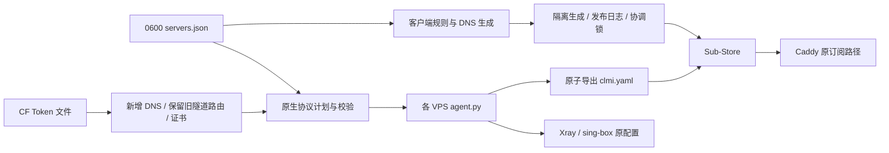

# ArgoSBX Fleet
维护已有 ArgoSBX + Cloudflare Tunnel + Sub-Store 安装。支持多机协议参数、订阅生成、发布恢复及增量域名迁移。代理内核继续由原生 systemd 服务运行，不依赖 Ti、3x-ui、Docker 或新增常驻管理进程。
## 结构

## 安装维护工具
需要 Python 3.10+、PyYAML。不会替换或重启 Xray、sing-box、cloudflared、Caddy、Sub-Store；这不是空白 VPS 的全量代理安装器。
从 GitHub Release 下载版本包和 SHA256SUMS，核验后运行：
```sh
sha256sum -c SHA256SUMS
python3 install.py argosbx-fleet-v1.0.4.tar.gz --sha256 <已核对的SHA256>
```
安装到 `/opt/argosbx-fleet/v1.0.4`，原子更新 `current` 符号链接。同一版本内容不可覆盖。升级使用相同命令；数据与凭据不在发布包内。
## 配置入口
复制 `templates/servers.example.json` 到私有路径，设置权限 0600；通过 `ARGOSBX_SERVERS_FILE` 指定。`ARGOSBX_WORKSPACE` 用于解析相对 SSH 路径；`ARGOSBX_STATE` 为计划和恢复日志目录。设置 `coordinator` 为运行 Sub-Store 的服务器 ID，使用该机原生 `flock` 排除跨工作站同时发布。每次 Sub-Store 请求前后检查锁连接；检测到连接断开就停止写入并保留恢复日志。它不提供服务端数据库 fencing，已在途的请求仍须回读确认。
初次接管现有安装：向各 VPS `agent.py adopt` 标准输入传递 `{server_id, services}`；services 是原生配置完整路径到 systemd unit 的映射。程序读取实际端口、TLS 参数、凭据和源节点，校验两个内核并确认接管前后正式节点等价，再保存 `/etc/argosbx-fleet/server.json`。同类协议存在多个入站时拒绝自动猜测；需要先明确映射。
```sh
python3 fleetctl.py inspect --server jp
python3 fleetctl.py protocol-plan --server jp
python3 fleetctl.py protocol-apply --server jp
python3 servers.py plan
python3 servers.py publish
```
`protocols` 包含 `reality/hy2/cf/anytls/shadowtls/salamander`，各自显式设置 enabled、port、listen；TLS 协议通过 certificate 引用 certificates 中的证书文件。另有 sni、cover_host、cover_port、alpn、ws_path、padding_scheme、client 参数。导出根据协议标识和原生配置读取凭据，不依赖节点数组下标、固定端口、固定 tag。直接编辑 native 文件会触发漂移保护，不会无声发布不一致节点。生成器显式使用本次 inventory；多次生成及域名迁移不会沿用模块导入时的旧域名映射，私有 payload 从创建起即为 0600。schema=2 必须显式填写已登记协议的完整参数和证书绝对路径；不支持的参数会报错，清空 client 选项或 ALPN 后不会从旧模板继承。只部署部分协议的服务器不会生成不存在的 Shadowrocket 节点；整台停用应从汇总配置移除，不能发布空国家组。
启停监听、修改端口等需要原生服务重启；默认拒绝修改。只有明确维护窗口才使用 `protocol-apply --allow-restart`。普通参数计划、订阅调整、导出器升级均不重启代理。`enabled=false` 会从服务端和订阅同时移除该入口；已有凭据保留在私有接管状态中，便于再次启用。
## 发布与恢复
`servers.py plan` 创建随机命名的临时 Sub-Store 对象，使用原生转换器校验 Clash、Stash 和 Shadowrocket 分组，随后删除。`publish` 检查输入和每个线上对象未被修改，记录写前日志后更新并回读原统一地址。它是可恢复的多对象发布，不是 Sub-Store 数据库级原子事务。
进程或网络中断后运行 `servers.py recover`，按线上内容恢复本次写入并清理临时对象。恢复前先核对所有待恢复对象，遇到第三方修改保留日志并拒绝开始覆盖。临时对象按资源清单核对存在性，已删除、未创建或删除响应丢失均可重复恢复，清理进度逐项落盘。日志0600、原子替换并 fsync；成功后删除，不长期累计备份。不要绕过工具在发布期间编辑同一 Sub-Store 对象。
服务器端未完成的协议事务由 `fleetctl.py protocol-recover --server jp` 恢复；已尝试重启过的服务在恢复时也会重启，未重启过的事务不会触发服务重启。恢复命令也默认拒绝重启，只有明确指定 `--allow-restart` 才会恢复已重启的服务；恢复前统一核对原生文件、登记状态和订阅源，存在外部修改时整次停止。恢复同时还原源文件和读取权限，清除过期计划；未恢复事务会阻止定时导出和发布。
## 域名迁移
CF Token 通过本机 0600 文件引用，不写进 Git 或子进程参数。权限为 Zone Read、DNS Edit、Account Cloudflare Tunnel Edit，限制到目标 zone/account；R2/S3 Token 不可替代。`Cloudflare.zones()` 支持分页读取授权范围内的域名。
私有配置增加 `cloudflare.token_file`，目标服务器增加 `domain_migration: {zone, tunnel_id, names: {ipv4, ipv6, cf, certificate}}`。
```sh
python3 fleetctl.py domain-plan --server jp
python3 fleetctl.py domain-stage --server jp
python3 fleetctl.py domain-commit --server jp
```
先新增 DNS 和隧道路由，保留原名称；遇到已有不一致记录拒绝覆盖。Caddy 使用现有进程热加载签发证书，证书就绪后才能提交协议引用。若进程中断在 DNS 完成、证书登记之前，提交会停止，必须先恢复再重新执行，不能跳过证书阶段。证书身份切换涉及原生进程重新加载时默认停止，待维护窗口指定 `--allow-restart`。新连接地址可以继续使用原证书 SNI；只有显式要求更换 TLS 身份才安排切换。原订阅 URL、认证路径和源地址不随域名迁移改变。
域名恢复使用 `domain-recover`，仅删除带本次事务标记的新增 DNS，避免误删他人记录。提交后的 DNS 不单独删除；先恢复客户端与服务端引用。实际新域名切换必须有有效管理 Token 和目标域名，本仓库的模拟测试不能代替真实外网验收。
## 分流与测速
继续使用 [MetaCubeX/meta-rules-dat](https://github.com/MetaCubeX/meta-rules-dat) 国内域名/IP 与广告集合，日更且使用客户端缓存。优先保留 Google Play、AI、Telegram 例外；飞书业务/静态资源显式直连。Clash 的国内 DNS 跟随相同国内规则集，Stash 使用原生 geosite:cn 策略；国内走 AliDNS HTTPS，国外走代理上的 Cloudflare HTTPS。禁用明文 DNS 回退，节点解析保留独立启动路径。Shadowrocket 使用对应 ChinaMax DOMAIN-SET；其 DNS 覆写用于直连规则，改用国内 DoH，代理域名仍交给节点解析，保留独立原生格式。参见 [Stash DNS](https://stash.wiki/features/dns-server)、[Mihomo DNS](https://wiki.metacubex.one/config/dns/) 及 [Shadowrocket 配置说明](https://github.com/LOWERTOP/Shadowrocket/wiki#修改dns)。
`health.interval` 统一支持 900 或 1800 秒，默认 900。日常、AI、Telegram、国家自动组、去广告开关及现有节点名称保留。Clash/FlClash 导出始终是带规则分组的完整配置。
## 验证
```sh
python3 -B -m unittest discover -s tests -v
python3 release.py dist
```
测试涵盖协议参数、导出、并发/中断恢复、域名冲突、发布格式和升级校验。生产验收额外比较代理进程 PID、原生配置哈希、订阅节点、原统一 URL 和隔离客户端连接。HTTP 200 只代表请求成功，不等于登录后的业务全过程已验收。

## 证书与线上检查
`fleetctl.py inspect --server jp` 返回 `certificate_health`：剩余天数、14 天续期提醒、SNI/私钥匹配和有效期。计划、应用和订阅发布均阻止未生效、失效、不足 24 小时或不匹配的证书。检查只读，不自行续签、重启或修改现有 Caddy 自动续期流程。

## v1.1：空白服务器一键接入
控制机需要 Python 3.10+、PyYAML、OpenSSH；目标为 root 可 SSH 登录的空白 Ubuntu/Debian amd64 或 arm64。先核实主机指纹并写入专用 known_hosts，不能关闭 SSH 身份校验。控制机 `cloudflare.token_file` 指向 0600 Token 文件，权限为所选域名 Zone Read、DNS Edit，所选账号 Cloudflare Tunnel Edit；管理 Token 不上传 VPS，VPS 仅保存独立隧道连接 Token。
```sh
python3 onboard.py zones --config /private/servers.json
python3 onboard.py add --config /private/servers.json --server jp2 --country JP --country-name 日本 --ipv4 192.0.2.20 --zone example.com --ssh-key ~/.ssh/vps --known-hosts ~/.ssh/vps_known_hosts
python3 onboard.py install --config /private/servers.json --server jp2
```
`add` 生成完整可编辑的默认值、独立域名及随机私密源路径。`install` 串联主机检查、校验固定版本二进制、创建固定隧道、DNS、Caddy ACME 证书、两个代理内核、导出定时器、外部 HTTPS 源验收、Sub-Store 源自动登记与原统一订阅更新。已有统一地址不变。不得把现有 VPS 当成空白机；检测到已有安装即拒绝覆盖。安装中断后用原配置重复同一命令续装，保留第一次生成的节点凭据。
证书通过 Caddy 自动续期，协议使用稳定文件引用。云防火墙需要提前放行 TCP 80/443/8443/2447/2448 和 UDP 2446/8443（若调整端口，以初始化检查输出为准）；主机 UFW 已启用时仅追加这些端口，不清空规则。服务商防火墙没有通用 API，安装器不会冒充已自动放行。UDP 公网可达性仍须从实际客户端验证。CF 创建失败保留私有接入日志，未知响应通过同一随机隧道名称回读，避免重复创建。

## 多入站模型
现有六种协议类型均可首次新增或增设多个入口。复制 `protocols.anytls` 到 `protocols.anytls_second`，增加 `"type":"anytls"`、更换未占用端口，即得到独立凭据和带 `@anytls_second` 后缀的节点。CF 入站需独立 WS 路径；域名可以共用。应用时自动同步所选服务器的隧道路径和新增 DNS，保留其他入口；未知结果保留恢复日志。删除整个 ID 是永久移除该入口；`enabled:false` 则保留身份以便恢复。未知协议类型会明确拒绝，不会伪造可用节点。
```sh
python3 fleetctl.py protocol-plan --server jp
python3 fleetctl.py protocol-apply --server jp --allow-restart
python3 servers.py plan
python3 servers.py publish
```
新增、移除原生监听必须在允许重连的维护窗口应用；默认仍拒绝重启。当前已登记入口的名称和凭据保持不变。Sub-Store 新源在原生服务、证书和源导出验收后自动创建，失败恢复可删除本次创建的对象，且检测第三方并发修改。
